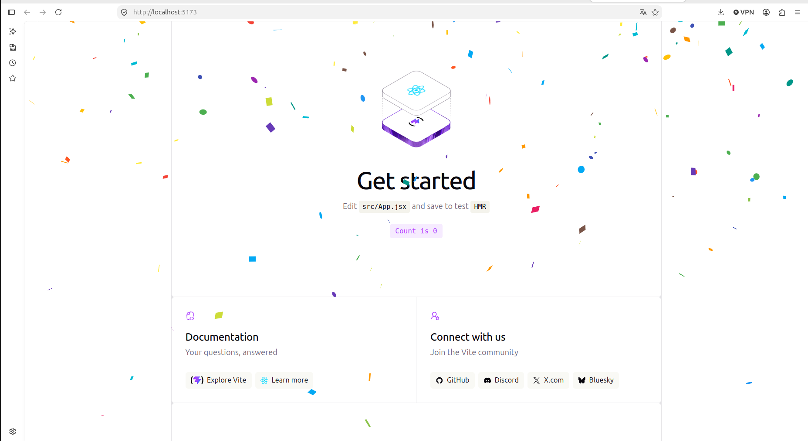
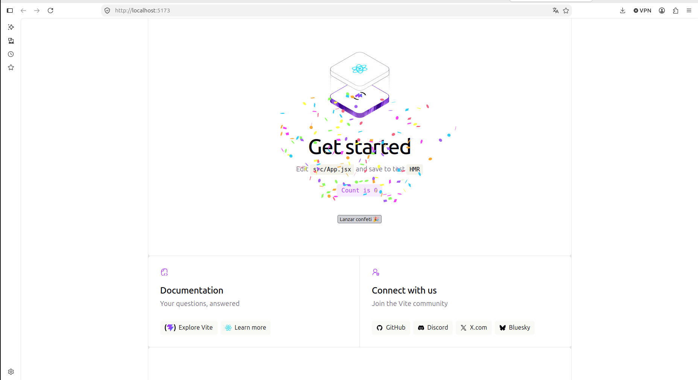
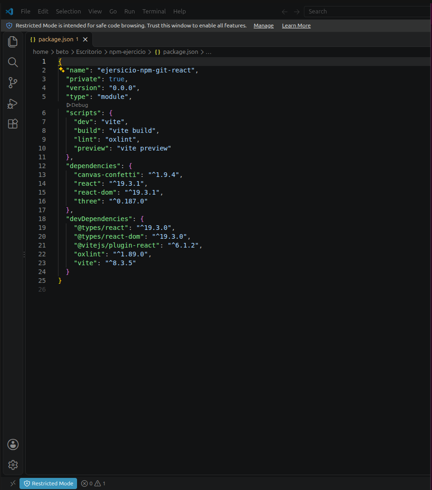
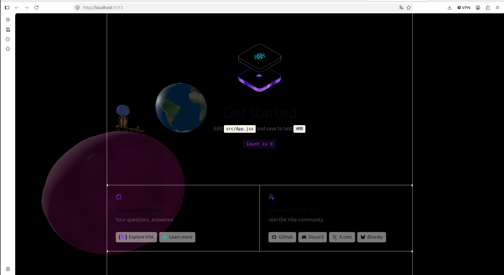

# Práctica React, Vite, npm y Git

## 1. Descripción del proyecto

Proyecto desarrollado con React y Vite para practicar la gestión de dependencias con npm, el uso de ramas en Git, la integración de componentes y el despliegue de aplicaciones web.

## 2. Ramas del repositorio

Se han creado cuatro ramas:

- **main:** versión principal que integra Canvas Confetti y Three.js.
- **react-confetti:** implementación de confeti automático.
- **canvas-confetti:** implementación de confeti mediante un botón.
- **three:** implementación de una escena 3D animada.

## 3. Capturas de pantalla

### React Confetti

### Canvas Confetti

### Dependencia en package.json

### Escena 3D con Three.js

## 4. Pregunta de la práctica

**Si la carpeta node_modules/ está excluida, ¿borrar una dependencia hace alguna acción sobre el repositorio? ¿Cuál?**

Sí. Aunque la carpeta `node_modules/` esté excluida mediante `.gitignore`, cuando desinstalamos una dependencia utilizando `npm uninstall`, se modifican los archivos `package.json` y `package-lock.json`.

Estos archivos sí están incluidos en el repositorio, por lo que Git detectará sus modificaciones y podremos registrarlas mediante un commit.

La carpeta `node_modules/` no necesita subirse a GitHub, porque todas las dependencias pueden volver a instalarse mediante `npm install`.

## 5. Tecnologías utilizadas

- React
- Vite
- JavaScript
- npm
- Git y GitHub
- Three.js
- React Confetti
- Canvas Confetti

## 6. Despliegue

La aplicación está publicada en GitHub Pages.

**Web:** https://pabconfer.github.io/npm-ejercicio-deploy/

**Repositorio del despliegue:** https://github.com/pabconfer/npm-ejercicio-deploys